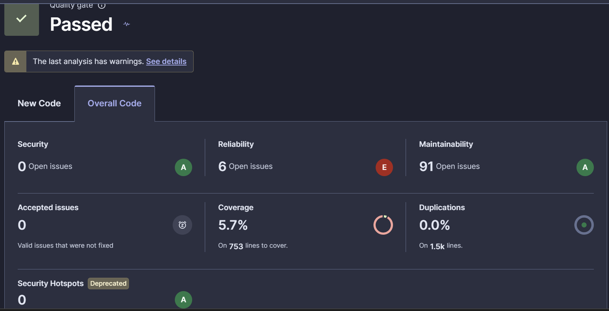

# Calidad del software: resultados de SonarQube

## Análisis proporcionado

El panel **Overall Code** de SonarQube muestra los siguientes valores, **medidos antes de las últimas correcciones**:

| Indicador | Valor |
|---|---|
| Quality Gate | **Passed** |
| Seguridad | **A**, 0 incidencias |
| Fiabilidad | **E**, 6 incidencias |
| Mantenibilidad | **A**, 91 incidencias |
| Cobertura de pruebas | **5,7 %** de 753 líneas susceptibles de cobertura |
| Código duplicado | **0,0 %** (aprox. 1,5 mil líneas) |
| Security Hotspots | **0** |
| Incidencias aceptadas | **0** |



El servidor indica que el último análisis contiene advertencias cuyo detalle aún no se ha facilitado. El estado `Passed` depende de las condiciones del *Quality Gate* y no implica que todo el código carezca de errores.

## Problemas principales y soluciones

- **Fiabilidad en la gestión de archivos:** SonarQube señala cierres inseguros y riesgos en entrada/salida. `TOPTWReader.readProblem()`, `ExpositoUtilities.printFile()` y `writeTextToFile()` utilizan `try-with-resources` en esta versión.
- **Iterador de `PowerSet`:** `iterator()` devuelve un recorrido nuevo cada vez, y `next()` lanza `NoSuchElementException` al agotarse.
- **Comparación confusa en `TOPTWSolution`:** `equals(TOPTWSolution)` se renombra a `hasSamePredecessors(TOPTWSolution)`, porque solo compara predecesores y no representa la igualdad completa de objetos.
- **Complejidad de `TOPTWGRASP`:** se propone extraer métodos más pequeños y añadir pruebas de regresión; se mantiene la heurística intacta para evitar cambios funcionales innecesarios.
- **Cobertura del 5,7 %:** se amplía la batería de pruebas JUnit, pero falta una nueva medición para cuantificar la mejora.

Los avisos de mantenibilidad adicionales (convenciones, clases anónimas, código comentado y `System.out`) pueden abordarse de manera gradual. No es necesario resolver los 91 para justificar las principales problemáticas solicitadas.

## Comprobación posterior

Ejecutar desde la raíz del proyecto:

```bash
mvn clean verify
mvn sonar:sonar -Dsonar.host.url=http://localhost:9000
```

Revisar el panel de SonarQube de nuevo y comparar resultados. **No reemplazar las cifras observadas por estimaciones.** El informe técnico amplía estas decisiones y distingue correcciones aplicadas de propuestas pendientes.
