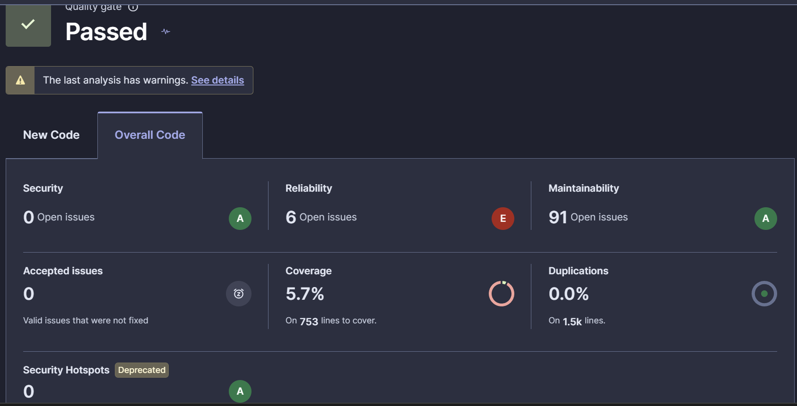

# 1. Introducción y alcance

El trabajo se basa en **ExpositoTOP**, proyecto Java del recomendador turístico con ventanas de tiempo (RTVRPTW) suministrado en el campus virtual. La actividad consiste en migrarlo a Maven, comprender su ciclo de construcción, configurar plugins, analizar su calidad con SonarQube y publicar documentación técnica con Doxygen, Graphviz y MkDocs Material mediante MkDoxy.

El alcance de la adaptación se ha mantenido deliberadamente limitado: se conserva la estructura funcional del algoritmo y se han hecho correcciones justificadas por fallos visibles en el código original. Se incorporan pruebas y documentación, sin desarrollar funcionalidades adicionales del recomendador.

# 2. Maven: arquitectura, ciclo de vida y uso

**Maven** es una herramienta de gestión y automatización de construcción basada en el **Project Object Model (POM)**. El fichero `pom.xml` centraliza identificación del artefacto, dependencias, versiones y configuración de plugins. Maven utiliza una estructura estándar: `src/main/java` para producción, `src/test/java` para pruebas y `target` para salidas.

El ciclo **default** encadena fases: `validate`, `compile`, `test`, `package`, `verify`, `install` y `deploy`; ejecutarlas por separado facilita estudiar su propósito. Además existen los ciclos `clean` (eliminación de resultados previos) y `site` (publicación de información del proyecto).

| Comando | Finalidad | Resultado esperado |
|:--|:--|:--|
| `mvn -version` | Verificar instalación | Versión de Maven y Java activo |
| `mvn validate` | Validar POM | Modelo correcto |
| `mvn compile` | Compilar | Archivos `.class` en `target/classes` |
| `mvn test` | Ejecutar JUnit | Informe de pruebas Surefire |
| `mvn package` | Empaquetar | JAR en `target/` |
| `mvn verify` | Completar verificaciones | Reporte JaCoCo XML |
| `mvn install` | Instalar en repositorio local | Artefacto en `.m2/repository` |
| `mvn deploy` | Publicar a otro repositorio | Copia en `target/repositorio-maven/` |

Las fases se pueden invocar desde **la terminal integrada de IntelliJ** o desde la ventana **Maven → Lifecycle**. La instalación debe comprobarse en el equipo de entrega con una captura del resultado de `mvn -version`.

# 3. Conversión de ExpositoTOP al proyecto Maven

El archivo original contenía **11 clases Java** distribuidas en `top`, `es.ull.esit.utilities` y `es.ull.esit.utils`. Las clases se han trasladado a `src/main/java` conservando sus paquetes. Se han incluido los ficheros de instancias TOPTW requeridos por la aplicación y un POM con artefacto `es.ull.esit:rtvrptw:1.0-SNAPSHOT`.

Se mantiene el punto de entrada `top.mainTOPTW`. Para facilitar pruebas de funcionamiento se admite una ejecución sobre una única instancia sin ejecutar todo el lote original:

```text
java -jar target/rtvrptw-1.0-SNAPSHOT.jar c101Recortada.txt 2 3
```

La clase principal conserva el modo original por lotes si no se le pasan argumentos. Esta ejecución completa puede resultar costosa y generar abundante salida.

**Verificación realizada en el entorno de preparación:** las 11 clases compilaron correctamente con `javac` del JDK 21. Se ejecutó la instancia `c101Recortada.txt` durante una iteración y terminó con código 0, mostrando las líneas de puntuación media y mejor solución. **Las fases de Maven no se han ejecutado aquí**, puesto que Maven y sus dependencias no estaban disponibles en el entorno de preparación. Deben comprobarse en IntelliJ y la terminal local.

# 4. Plugins del POM: configuración y valoración (actividad 6)

| Plugin | Propósito | Valoración práctica |
|:--|:--|:--|
| `maven-compiler-plugin` | Compilar con API objetivo Java 17 | Evita discrepancias entre IDE y consola |
| `maven-surefire-plugin` | Detectar y ejecutar JUnit 5 | Introduce verificación automática reproducible |
| `jacoco-maven-plugin` | Generar cobertura XML en `verify` | Aporta datos de prueba al análisis SonarQube |
| `maven-jar-plugin` | Declarar clase principal en el JAR | Permite una prueba funcional con `java -jar` |
| `maven-deploy-plugin` | Publicar el artefacto en repositorio de archivos | Demuestra la fase `deploy` sin credenciales externas |
| `sonar-maven-plugin` | Ejecutar el análisis de SonarQube | Integra análisis estático y construcción |

La configuración incluye **versiones explícitas** para limitar variaciones, dependencia JUnit solo en alcance `test` y una ruta local de demostración para `deploy`. El uso de JaCoCo y de SonarScanner se mantiene separado: JaCoCo **mide cobertura**, mientras SonarQube **analiza código y recibe** el informe producido.

# 5. Análisis SonarQube: resultados obtenidos (actividad 7)

Se ha analizado el proyecto RTVRPTW en SonarQube y se han revisado el panel general y la lista de incidencias, aportados mediante una captura de pantalla y una grabación de la navegación por el informe. El analizador se integró con Maven y la cobertura de JaCoCo se configuró mediante el fichero `target/site/jacoco/jacoco.xml`.

Para reproducir el análisis desde la raíz del proyecto:

```text
mvn clean verify
mvn sonar:sonar -Dsonar.host.url=http://localhost:9000
```

El servidor debe estar iniciado y el token de acceso configurado como `SONAR_TOKEN`; no se incluye ningún token en el repositorio. La dirección del servidor es ilustrativa y se ajustará si la instalación emplea otro puerto o equipo.

## 5.1. Métricas reales del análisis

Los siguientes valores se han transcrito del panel **Overall Code** facilitado para esta práctica. Son los resultados **anteriores a las nuevas correcciones** y no deben presentarse como métricas obtenidas tras ellas.

| Métrica | Resultado observado | Interpretación |
|:--|:--|:--|
| Quality Gate | **Passed** | Supera las condiciones del perfil de calidad configurado. |
| Seguridad | **A; 0 incidencias abiertas** | No se notifican problemas de seguridad en el análisis. |
| Fiabilidad | **E; 6 incidencias abiertas** | Principal aspecto a corregir: posibles fallos durante la ejecución. |
| Mantenibilidad | **A; 91 incidencias abiertas** | El mantenimiento es aceptable según la calificación, pero existen numerosos avisos de mejora. |
| Cobertura de pruebas | **5,7 %** | Cobertura reducida sobre **753 líneas** susceptibles de cubrirse. |
| Duplicación de código | **0,0 %** | No se detecta código duplicado sobre aproximadamente **1,5 mil líneas** analizadas. |
| Incidencias aceptadas | **0** | No existen incidencias marcadas como aceptadas. |
| Security Hotspots | **0** | No se muestran puntos sensibles pendientes de revisión. |

{ width=95% }

La captura también muestra el aviso **«The last analysis has warnings»**. Se constata la existencia de advertencias, pero no se ha aportado el detalle de su causa; por tanto, no se atribuyen a un problema concreto de configuración.

El estado **Passed** no contradice las seis incidencias de fiabilidad: el *Quality Gate* depende de las condiciones activas y puede centrarse en el **código nuevo**, mientras que aquí se presentan las métricas de **Overall Code**. La calificación A en mantenibilidad tampoco significa que las 91 incidencias carezcan de importancia, puesto que la calificación considera la deuda técnica relativa.

## 5.2. Valoración del resultado

La ausencia de incidencias de seguridad y de duplicaciones es positiva. No obstante, la **fiabilidad E** exige priorizar las incidencias que puedan causar excepciones o un uso incorrecto de los recursos. La **cobertura del 5,7 %** limita la confianza en los cambios: se necesitan pruebas adicionales de los casos más relevantes. Las 91 incidencias de mantenibilidad no justifican reescribir todo el algoritmo de la práctica; corresponde elegir correcciones pequeñas y de alto impacto, y justificar las mejoras restantes.

# 6. Principales problemáticas identificadas y propuestas (actividad 8)

Al revisar el listado mostrado en el vídeo se reconocen avisos concretos de SonarQube relacionados con la gestión de recursos, el comportamiento de los iteradores y la comparación de objetos. También aparecen avisos sobre métodos con una complejidad cognitiva elevada y cuestiones de estilo. Se seleccionan **solo los problemas representativos**, priorizando la fiabilidad y la conservación del funcionamiento del recomendador.

**1. Gestión incorrecta de recursos de entrada/salida (fiabilidad).** El vídeo muestra avisos de cierre inseguro, riesgo de `NullPointerException` y recursos que podrían quedar abiertos. Los casos afectan a `TOPTWReader.readProblem()` y a `ExpositoUtilities.printFile()` / `writeTextToFile()`. **Solución:** usar `try-with-resources` y propagar correctamente los errores de lectura, en lugar de finalizar toda la JVM. **Estado: corregido** en el ZIP actualizado.

**2. Iteración no reutilizable en `PowerSet` (fiabilidad).** El método `iterator()` devolvía el propio objeto, impidiendo recorrerlo independientemente varias veces; también se detectó el comportamiento al agotarse. **Solución:** crear un iterador nuevo en cada llamada y lanzar `NoSuchElementException` desde `next()` cuando corresponda. **Estado: corregido**, con pruebas de recorridos independientes.

**3. Método `equals` engañoso en `TOPTWSolution` (fiabilidad).** `equals(TOPTWSolution)` se podía confundir con una sobrescritura de `Object.equals(Object)` cuando únicamente comparaba predecesores. **Solución:** denominarlo `hasSamePredecessors(TOPTWSolution)` e implementar la comparación con `Arrays.equals`. **Estado: corregido**; no se altera el cálculo de las rutas.

**4. Elevada complejidad en `TOPTWGRASP` (mantenibilidad).** SonarQube muestra avisos de complejidad cognitiva en métodos principales de la heurística. **Propuesta:** dividir la construcción y evaluación de candidatos en métodos privados y comprobar el comportamiento con pruebas de regresión. **Estado: propuesta no aplicada**, porque un cambio amplio excede lo necesario para esta actividad y puede afectar al algoritmo.

**5. Cobertura de pruebas reducida (calidad general).** La cobertura observada es del **5,7 %**. **Propuesta:** añadir pruebas de lectura, escritura, iteración, parámetros y evaluación; generar un informe JaCoCo y repetir el análisis. **Estado: pruebas ampliadas**, pero falta un segundo análisis y **no se afirma ningún porcentaje posterior**.

## 6.1. Cambios específicos incorporados al código

En el proyecto entregado se han conservado las clases y el mecanismo de resolución. Los cambios nuevos respecto del ZIP anterior son tres:

1. `ExpositoUtilities.writeTextToFile()`: el `BufferedWriter` queda dentro de `try-with-resources` y se cierra aun cuando la escritura lance una excepción.
2. `PowerSet.iterator()`: cada llamada crea un nuevo iterador con estado independiente, de modo que dos recorridos `for-each` pueden completarse de principio a fin. La comprobación del final del iterador y el uso de `LinkedHashSet` ya estaban corregidos.
3. `TOPTWSolution`: el método `equals(TOPTWSolution)` pasa a denominarse `hasSamePredecessors(TOPTWSolution)`. Se usa `Arrays.equals` para comparar el contenido de los predecesores sin alterar el contrato de `Object.equals(Object)`.

Se incorporan pruebas de escritura, recorridos repetidos y comparación de predecesores. En la adaptación anterior ya se habían corregido `TOPTWReader`, `ExpositoUtilities.printFile()`, `TOPTWEvaluator` y la validación de parámetros de GRASP. Estas modificaciones son puntuales y **no convierten automáticamente las seis incidencias del análisis previo en cero**: es necesario ejecutar de nuevo SonarQube para verificar cuáles se han resuelto.

## 6.2. Decisiones sobre incidencias que no se corrigen

No se han corregido de forma indiscriminada los 91 avisos de mantenibilidad. Los relativos a nombres de variables, declaraciones en líneas separadas, comentarios inactivos, uso de `System.out` en una aplicación de consola y sustitución de clases anónimas por expresiones lambda pueden estudiarse como trabajo incremental. Tampoco se ha cambiado la estructura de los métodos extensos de GRASP, porque implica un mayor riesgo funcional y requiere pruebas de regresión más amplias.

La prioridad aplicada ha sido **primero fiabilidad, después pruebas y por último estilo**, tal como corresponde a un mantenimiento justificado del proyecto original. Las métricas del apartado 5 describen el estado mostrado por la captura y el vídeo; cualquier resultado posterior debe obtenerse en una nueva ejecución y registrarse por separado.

# 7. Doxygen, Graphviz y MkDocs (actividad 9)

Se añadieron comentarios compatibles con Doxygen (`\\brief` y descripciones de los componentes principales) a los archivos Java. **Doxyfile** define la extracción de código Java, generación HTML/XML/LaTeX y diagramas mediante `HAVE_DOT = YES`. **mkdocs.yml** usa el tema **Material** y el plugin **MkDoxy** para incorporar la referencia API al portal Markdown.

En `docs/` se incluyen una introducción, guía de uso, arquitectura, análisis de calidad y un registro de decisiones. Estos textos se elaboraron con asistencia de LLM, contrastándolos con las clases originales y sin atribuir métricas no observadas.

Para publicar la documentación:

```text
python -m pip install -r requirements-docs.txt
doxygen Doxyfile
mkdocs build --strict
```

Para obtener la documentación técnica en PDF **mediante Doxygen**, compilar el proyecto LaTeX de `target/doxygen/latex` con `make` / `make.bat` (requiere LaTeX) y copiar `refman.pdf` al repositorio como `documentacion-tecnica.pdf`. Se ha generado un **PDF de consulta provisional** a partir de los textos del portal, a la espera de reemplazarlo con el PDF nativo de Doxygen en el equipo de entrega.

# 8. Resultados, valoración y conclusiones

La adaptación permite organizar el proyecto con Maven, compilar y ejecutar las pruebas JUnit mediante un procedimiento común. JaCoCo y SonarQube aportan información complementaria: cobertura de pruebas y calidad estática, respectivamente.

El análisis real aportado obtuvo **Quality Gate Passed**, **seguridad A sin incidencias**, **fiabilidad E con seis incidencias**, **mantenibilidad A con 91 incidencias**, **cobertura del 5,7 %** y **0,0 % de duplicaciones**. Estos resultados indican que la mejora principal debe dirigirse a la **fiabilidad** y, en segundo lugar, a la **cobertura**; la mantenibilidad requiere una intervención selectiva.

En esta revisión se han completado tres correcciones puntuales y se han añadido pruebas, preservando el algoritmo principal. Se ha compilado el código fuente con `javac` y se ha ejecutado una instancia reducida correctamente en el entorno de preparación. **No se han podido ejecutar aquí ni Maven/JUnit ni una segunda medición de SonarQube**; por ello, no se atribuyen cifras posteriores a las modificaciones realizadas.

Como reflexión, SonarQube permite localizar defectos concretos y priorizarlos, pero el resultado «Passed» por sí solo no garantiza ausencia de fallos. Conviene valorar cada aviso según su impacto y verificar las correcciones mediante pruebas y un análisis repetido.

**Comprobaciones pendientes para la entrega:** ejecutar Maven desde IntelliJ y consola; repetir SonarQube, revisar el detalle de las advertencias y capturar las nuevas métricas; generar el HTML, el portal MkDocs y el PDF definitivo de Doxygen; publicar el repositorio y añadir su enlace. No se deben presentar como verificadas actividades que aún requieren estas ejecuciones.

**URL del repositorio GitHub:** `PENDIENTE: https://github.com/USUARIO/NOMBRE-REPOSITORIO`

# 9. Fuentes oficiales consultadas

- [Apache Maven — Ciclo de vida](https://maven.apache.org/guides/introduction/introduction-to-the-lifecycle.html)
- [Apache Maven — Maven en cinco minutos](https://maven.apache.org/guides/getting-started/maven-in-five-minutes)
- [SonarSource — SonarScanner para Maven](https://docs.sonarsource.com/sonarqube-server/analyzing-source-code/scanners/sonarscanner-for-maven/)
- [Doxygen — Manual](https://www.doxygen.nl/manual/)
- [MkDoxy — Guía de uso](https://mkdoxy.kubaandrysek.cz/usage/)
- [MkDocs — Redacción de documentación](https://www.mkdocs.org/user-guide/writing-your-docs/)

---

*Informe actualizado a partir del panel de SonarQube y del vídeo aportados. Se distinguen las métricas observadas de las correcciones implementadas, aún pendientes de un nuevo análisis.*
